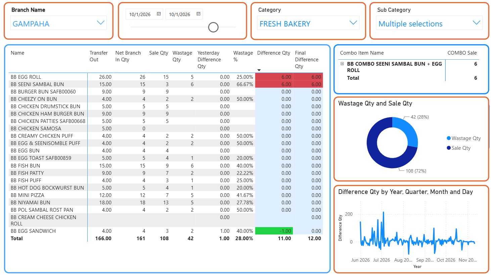
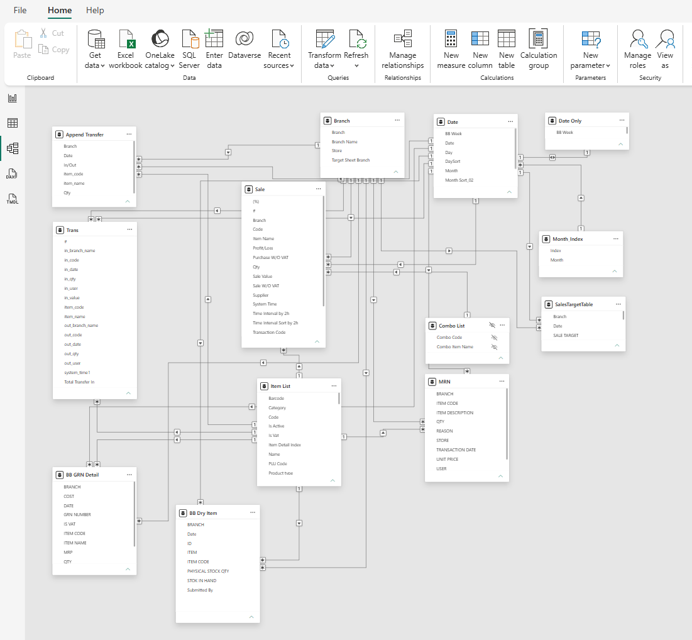

# Where did the bakery stock go?

**A Power BI case study in daily stock reconciliation across supermarket outlets**

When a bakery records a dispatch, the receiving outlet still has two questions to answer. Did the recorded quantity arrive? Can the outlet account for the units it received through sales, wastage and onward transfers? This dashboard follows fresh bakery products from dispatch through end-of-day review, so the bakery and branch teams can trace each discrepancy to the relevant records.

## Reading one branch-day

The Gampaha view shows **166 units dispatched**, **161 net units received**, **108 sold** and **42 recorded as wastage**.

| Review question | Calculation | What the reviewer learns |
| --- | --- | --- |
| How does dispatch compare with net receipts? | 166 − 161 = **5 units** | Check delivery notes, receipt postings and onward transfers. Net receipts already deduct branch transfers out. |
| How many net units remain unexplained today? | 161 − 108 − 42 = **11 units** | Review individual item movements to locate the variance. |
| What changes when yesterday is included? | 11 + 1 = **12 units** | The previous calendar day adds one unit to the two-day difference. |
| What share of recorded sales and wastage was wasted? | 42 ÷ (108 + 42) = **28%** | This denominator reproduces the percentage displayed for the selected branch-day. |

### Why item detail matters

The egg roll and seeni sambal bun each show a **+6** daily difference. The combo panel shows **6 sales** of a combo named for those two items. If each combo consumes one of each and those components are excluded from individual item sales, the six combos could explain both differences. The next check is the combo recipe and POS posting detail before adjusting either item.

The egg sandwich shows a different pattern. A daily difference of **−1** offsets yesterday’s **+1**, giving a final difference of **0**. Matching the correction to its source transaction establishes whether the earlier discrepancy was settled.

## How the model works

The measures compare transfer movements, POS quantities and MRN quantities under the selected branch, item and date. For fresh items expected to have zero opening and closing stock, daily difference equals inbound transfers less outbound transfers, sales and wastage. The previous-day measure shifts the calendar filter back one day. Products carried overnight require opening and closing stock quantities as well.

## Explore the project

- [DAX measures](dax/measures.dax) — dispatch, net receipts, sales, wastage and daily and previous-day differences. Comments identify the reconstructed definitions.
- [Business rules and worked example](docs/business-rules.md) — how receipt discrepancies, backdated wastage and next-day corrections affect the figures.
- [Semantic model notes](docs/semantic-model.md) — table roles, quantity signs and relationship checks for rebuilding the analysis.

This portfolio edition includes screenshots and measure definitions. Running the interactive report requires a Power BI model connected to equivalent source tables. To recreate the daily review, start with one branch, one date and one item, and compare the result with its transfer, sales and wastage records before reviewing the branch total.

**Hareendranatha Muthukumarana** · Business Analyst
